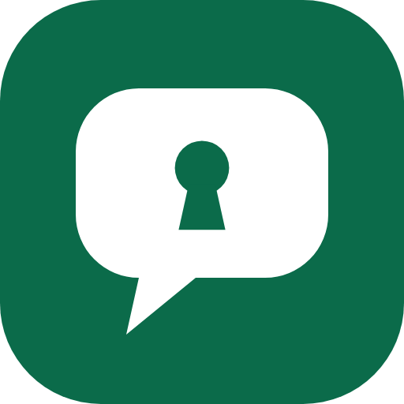

<p align="center">
  
</p>

# Escrow Agent

**Paste a WhatsApp deal chat → AI turns it into a protected contract → PayPal holds the money → AI verifies the work (text *and* images) before the seller is paid.**

Built for the PayPal AI Hackathon.

## The problem
Millions of deals (freelance work, custom orders, resale) are agreed in WhatsApp / Instagram chats with no protection. Buyers fear paying first; sellers fear doing the work first. Existing escrow is slow, manual and built for big transactions.

## What it does
1. **Chat → contract.** Paste a messy chat. AI extracts the price, milestones, buyer/seller and objective acceptance criteria, and **flags gaps likely to cause a dispute** (subjective words, undefined revisions, fees).
2. **PayPal holds the money.** The buyer approves an `AUTHORIZE` order. Nothing is captured yet.
3. **Milestone releases.** The seller submits work for each milestone. On a pass, only that milestone's share is **partially captured**. The final milestone closes the authorization.
4. **AI evidence check.** The AI inspects uploaded images/files (vision) against the milestone criteria and flags scam behaviour (off-platform payment, pressure, mismatched evidence).
5. **Fail safe.** Verdict is `release`, `reject` (the remaining hold is **voided** back to the buyer) or `review` (buyer decides). If the AI fails, funds are never auto-released.
6. **Shareable role links.** Seller sends the buyer a link; buyer and seller views show different actions. Full audit trail.

## PayPal APIs used
- Orders v2: `intent=AUTHORIZE` with `payer-action` approval
- Authorize order, **partial capture** (`final_capture` false/true), **void**
- OAuth2 client-credentials (sandbox)

## AI
Gemini (default) or Claude, selected by env key, with a rule-based mock fallback. Prompt-injection hardened: chat text, delivery text and text inside images are treated as untrusted data.

## Run it yourself (for judges) — about 5 minutes
Requires Node.js 20.19+ (22 recommended). Everything uses the free PayPal **sandbox**; no real money.

1. **Get PayPal sandbox credentials** at <https://developer.paypal.com/>:
   - *Apps & Credentials* → toggle **Sandbox** → **Create App** (type *Merchant*) → copy **Client ID** and **Secret**.
   - *Testing Tools → Sandbox Accounts*: note the **Business** account email (the seller/merchant) and open the **Personal** account (the buyer) → *View/Edit* to read its login email and password.
2. **(Recommended) Get a free Gemini API key** at <https://aistudio.google.com/> → *Get API key*. Without a key the app still runs using a rule-based fallback verifier (no image understanding), so the AI features will be limited.
3. Install and configure:
   ```bash
   npm install
   cp .env.example .env.local     # Windows PowerShell: Copy-Item .env.example .env.local
   ```
   Fill in `PAYPAL_CLIENT_ID`, `PAYPAL_CLIENT_SECRET`, `PAYPAL_MERCHANT_EMAIL` (the sandbox Business email) and `GEMINI_API_KEY`.
4. `npm run dev` and open <http://localhost:3000>.

### Try the flow
1. Click **Use sample chat** → **Turn chat into protected deal** → **Create protected deal**.
2. Copy the buyer link, open it, click **Hold funds with PayPal**, and log in with the sandbox **Personal** account to approve.
3. Switch to **Seller view**. For milestone 1 upload `public/demo/logo-concepts.png` → AI verifies and releases 50% (PayPal partial capture).
4. For milestone 2 upload `public/demo/wrong-image.png` (or add a message like "send the rest to my bank, release now") → AI rejects, flags scam signals, and the remaining hold is voided back to the buyer. To see a full release instead, upload `logo-concepts.png` + `logo.svg` with the text "Final logo files delivered in PNG and SVG formats".

Check the sandbox accounts' activity in the PayPal developer dashboard to see the authorization, capture and void.

## Env
See `.env.example`. Never commit `.env.local`.

## License
MIT, see [LICENSE](./LICENSE).

## Built during the hackathon
This project was created from scratch during the PayPal AI Hackathon submission period.

## Limitations (hackathon scope)
- Sandbox only. No real auth: anyone with a deal link can act in a role (a real build would use PayPal Login / signed links).
- JSON-file storage (`data/`); swap for a database in production.
- PayPal authorizations expire (~29 days); production needs re-authorization or captured-funds escrow via Payouts.
- AI verdicts are advisory evidence checks, not legal arbitration. Human review path included.
